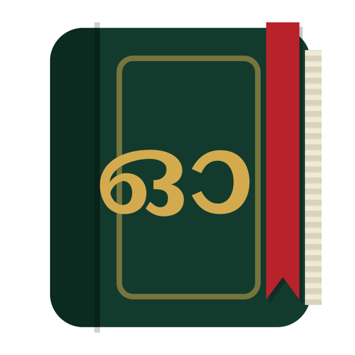
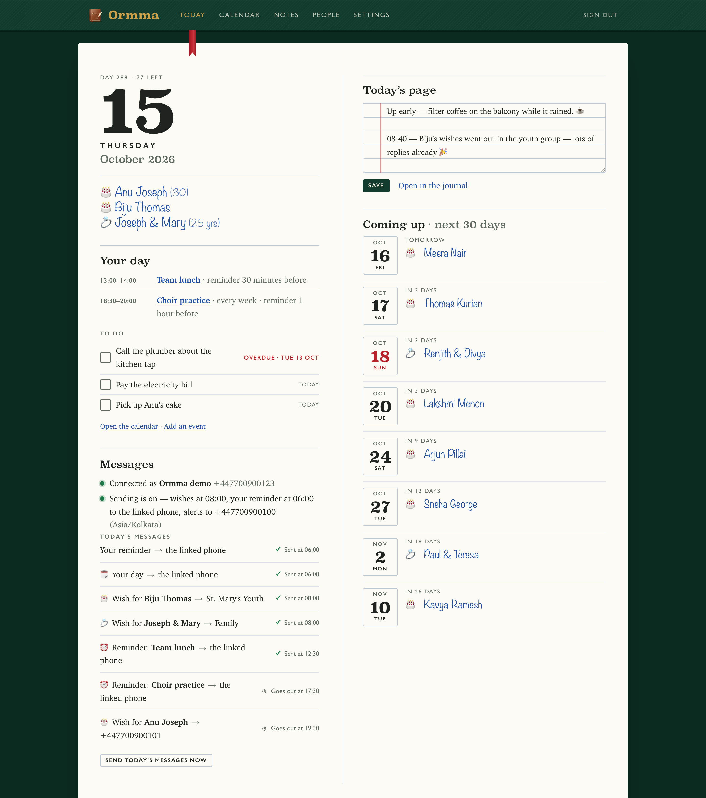
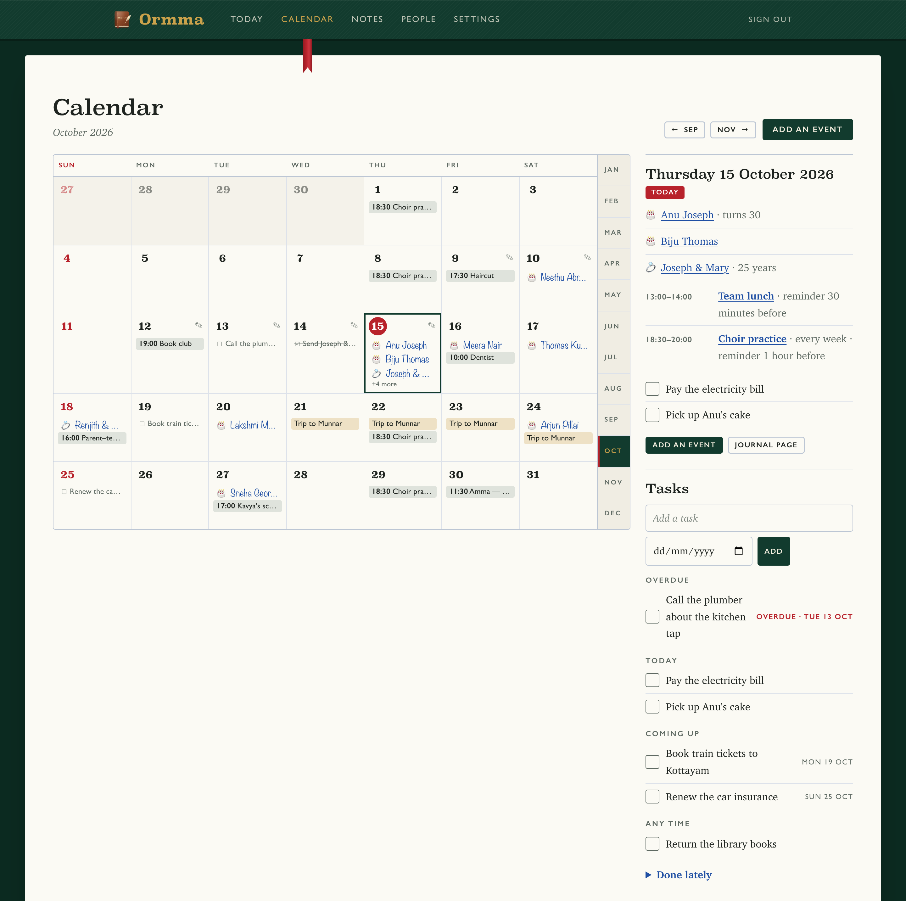
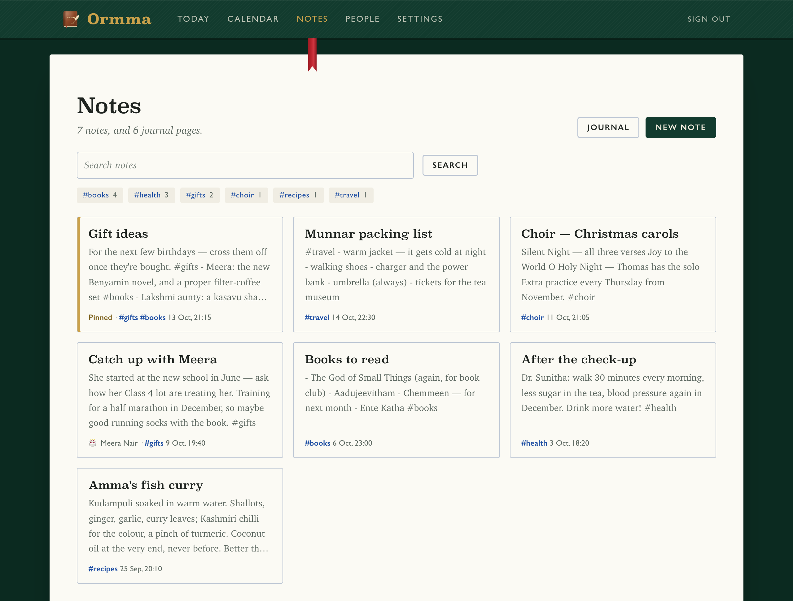
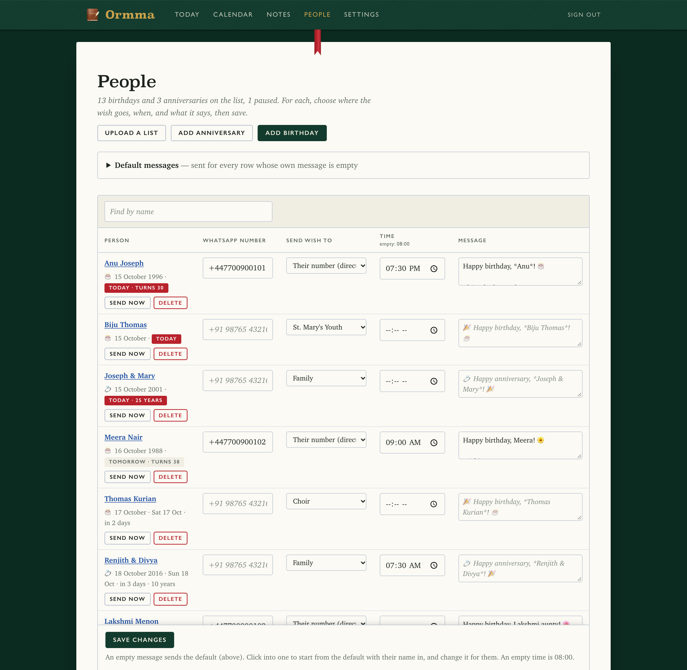
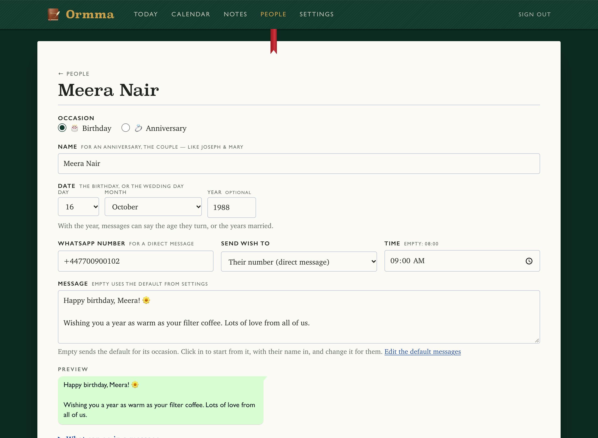
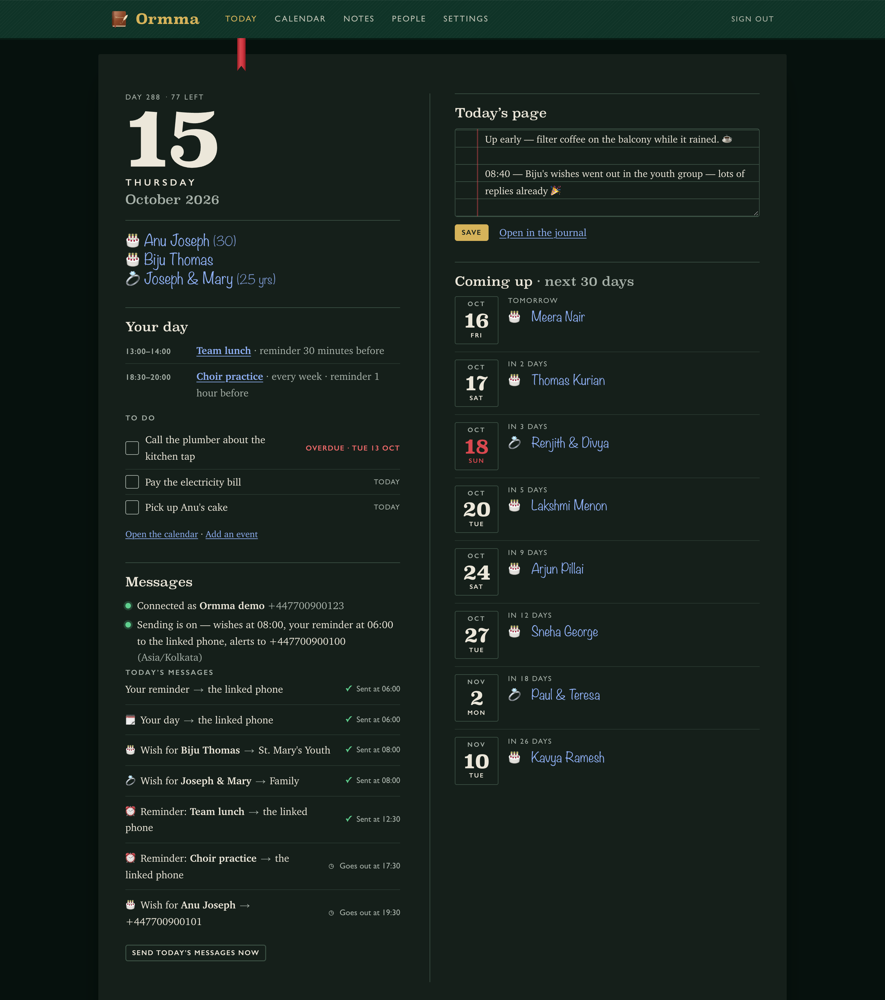
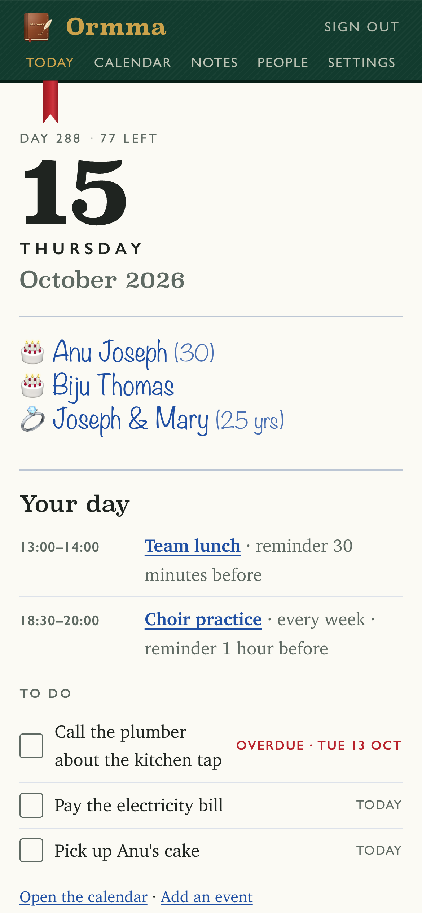

<p align="center"></p>

<h1 align="center">Ormma</h1>

<p align="center">Your diary and reminders, with WhatsApp as the way in and out.</p>

<p align="center">
  <a href="https://github.com/AnalytixKraft/Ormma/releases/latest"><b>Download for Mac or Windows</b></a> ·
  <a href="docs/install.md">Install guide</a> ·
  <a href="docs/guide.md">User guide</a> ·
  <a href="docs/building.md">Working on it</a>
</p>



- **A diary** — notes, and a journal page for each day, with #tags and search. Send `📝 Coffee with Tom` on WhatsApp and it is written on today's page.
- **A calendar, and reminders that keep coming until done** — events and tasks, added on the page or from WhatsApp: send `📅 Dentist Tue 10am` or `remind me to call Renjith`. Each morning “Your day” lists what the day holds.
- **The people to remember** — 🎂 birthdays and 💍 anniversaries, each wished on WhatsApp at its time, in a group or straight to their own number, with a morning reminder to you of every wish the day holds, and an alert when one was not sent.

Ormma runs on your own computer — your list, your calendar and your notes stay there — and you use it in the browser.

## Download

| | |
|---|---|
| **Mac** — Apple silicon or Intel, macOS 13.5 or newer | [`Ormma-<version>-mac.dmg`](https://github.com/AnalytixKraft/Ormma/releases/latest) |
| **Windows** — 10 or 11, 64-bit | [`Ormma-<version>-windows-setup.exe`](https://github.com/AnalytixKraft/Ormma/releases/latest) |

Install it, open it, choose a password, and link your WhatsApp. The downloads are not yet signed, so the first time, macOS or Windows asks whether to open an app from the internet: [the install guide](docs/install.md#the-desktop-app) shows what to click.

Linux, a home server, or a Mac you develop on: run it [from source](docs/install.md#from-source) — with Node on a Mac, or with Docker anywhere.

## A word about WhatsApp

> [!WARNING]
> **Link a spare WhatsApp number if you can, not your business one.** Ormma sends through WhatsApp Web as a *linked device* — an unofficial client, against WhatsApp's Terms of Service. WhatsApp can ban a number that uses one, with no warning, and the ban takes the whole account. A few messages a day is about as low-risk as this gets; it is not zero — and messages straight to people's numbers draw more attention than posts in groups.

Ormma is not made by, or connected with, WhatsApp or Meta.

## A look around

<table>
  <tr>
    <td width="50%" valign="top"><br><b>The calendar</b> — events, repeating or not, with reminders on WhatsApp; tasks, ticked off here or on Today.</td>
    <td width="50%" valign="top"><br><b>Notes</b> — a notebook with #tags and search, and notes about the people on your list.</td>
  </tr>
  <tr>
    <td width="50%" valign="top"><br><b>People</b> — upload a list from a spreadsheet; choose where each wish goes, when, and what it says.</td>
    <td width="50%" valign="top"><br><b>Each person</b> — their wish as it will look in WhatsApp, and your notes about them.</td>
  </tr>
  <tr>
    <td width="50%" valign="top"><br><b>At night</b> — the same diary in dark colours, when your computer is set to dark.</td>
    <td width="50%" valign="top" align="center"><br><b>On a phone</b> — through a <a href="docs/install.md#reach-it-from-anywhere">tunnel</a> of your own.</td>
  </tr>
</table>

## Documentation

- **[Install guide](docs/install.md)** — the Mac and Windows downloads; from source on a Mac or with Docker; keeping it running, updating, backing up, moving and uninstalling.
- **[User guide](docs/guide.md)** — getting started, people and their wishes, the morning reminder and alerts, the calendar and reminders from WhatsApp, notes and the journal, and what to do when something is not sent.
- **[The WhatsApp bridge](whatsapp/README.md)** — what it will and will not do, and its API.
- **[Working on Ormma](docs/building.md)** — the code, the tests, a demo that needs no WhatsApp, the screenshots, and building and releasing the downloads. Contributions are welcome: see [CONTRIBUTING.md](CONTRIBUTING.md).
- [CHANGELOG.md](CHANGELOG.md) · [SECURITY.md](SECURITY.md) — reporting a vulnerability

## How it fits together

```
 you, in a browser ──► app ─────────────► whatsapp (the bridge) ──► WhatsApp
 (localhost:3210)      pages, the list,   a linked device of the
                       the daily clock,   number: posts into groups
                       SQLite database    and to people's numbers,
                                          and hands over your 📅 and 📝
```

- **`app/`** — the pages, the database (people, settings, what was sent, your calendar and notes — one SQLite file) and the clock that sends each day's messages. Node 24, no framework, SQLite built in.
- **`whatsapp/`** — the bridge: holds the WhatsApp session, sends text to a group it is in or to a person's number, and hands the app the 📅 and 📝 messages from the chats you tick. Only this computer (or, in Docker, only the app) can reach it, and only with the token. It only messages numbers that are on WhatsApp, at most 30 direct messages an hour, and ignores messages from strangers. See [`whatsapp/README.md`](whatsapp/README.md).
- **`desktop/`** — the Mac and Windows app: the two above with their own Node, and a launcher that starts them when you sign in.

## Credits

Ormma is made by [AnalytixKraft](https://github.com/AnalytixKraft). The WhatsApp bridge is built on [Baileys](https://github.com/WhiskeySockets/Baileys) (MIT). QR codes by [uqr](https://github.com/unjs/uqr) (MIT). The desktop app bundles [Node.js](https://nodejs.org) (MIT); its Windows installer is made with [NSIS](https://nsis.sourceforge.io).

## Licence

Ormma is licensed under the [Apache License 2.0](LICENSE). You may use it, change it and share it, for any purpose. When you share it — or anything made from it — keep the [LICENSE](LICENSE) and [NOTICE](NOTICE) files with it, mark the files you changed, and keep the credit to AnalytixKraft that NOTICE carries.

The WhatsApp bridge relies, through Baileys, on [libsignal](https://github.com/WhiskeySockets/libsignal-node), which is GPL-3.0: whoever shares the bridge together with it shares that whole under the GPL-3.0's terms as well.
