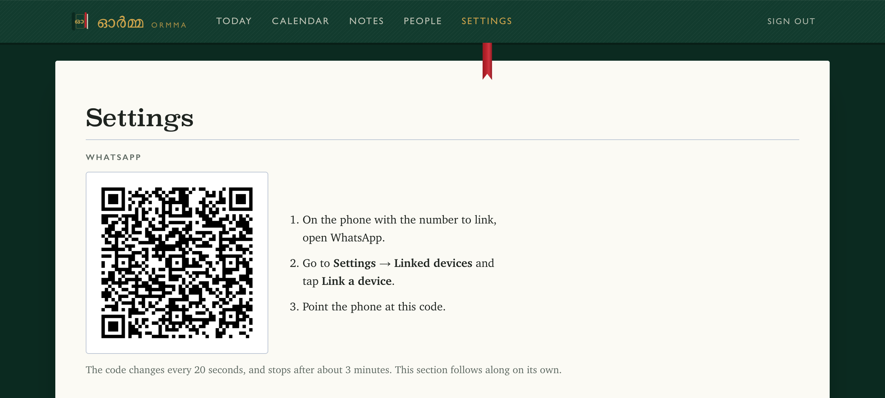
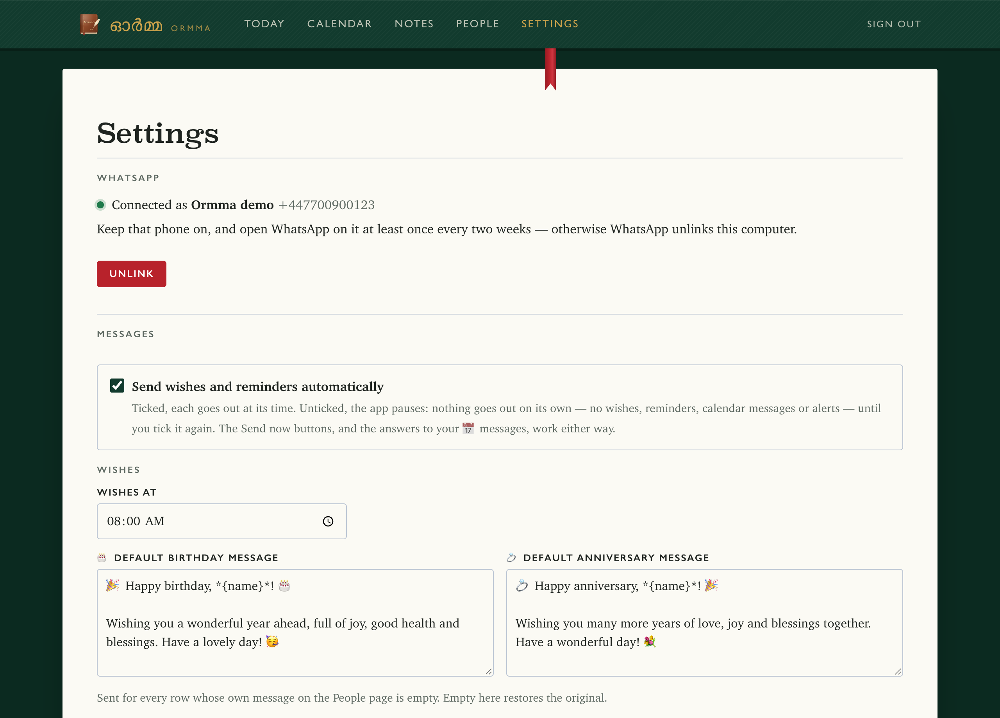
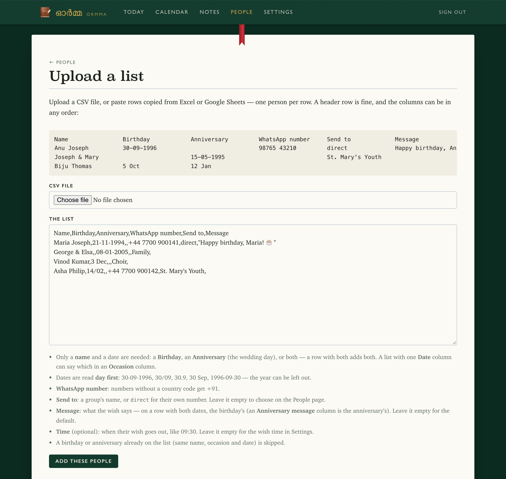
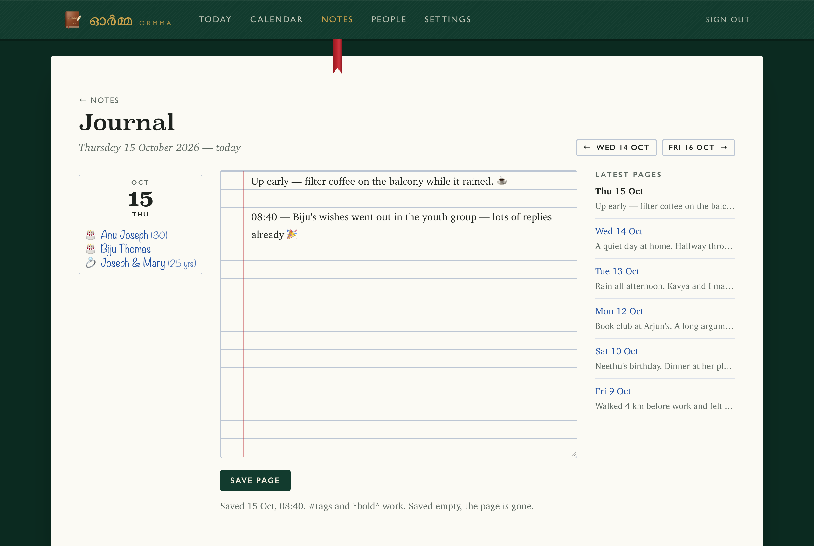

# Ormma — the user guide

What each part of Ormma does, and how to use it. To install it first, see [the install guide](install.md).

- [Getting started](#getting-started)
- [People and their wishes](#people-and-their-wishes) — [uploading a list](#uploading-a-list), [messages](#messages), [send now and previews](#send-now-and-previews)
- [The morning reminder](#the-morning-reminder) and [alerts](#alerts)
- [The calendar](#the-calendar) — [from WhatsApp](#add-to-the-calendar-from-whatsapp), [reminders](#reminders), [with Claude](#with-claude)
- [Notes and the journal](#notes-and-the-journal)
- [The password](#the-password)
- [When something is not sent](#when-something-is-not-sent)

## Getting started

Open Ormma — the desktop app opens it in your browser; run from source, it is at <http://localhost:3210> — sign in, and follow **Getting started** on the Today page:

1. **Link the WhatsApp number.** Settings → WhatsApp → *Link a phone*. On the phone: WhatsApp → Settings → Linked devices → Link a device, and scan the code.

   

2. **Upload your list** on *People → Upload a list* — or use *Add birthday* and *Add anniversary*.
3. **Choose where each wish goes.** On the People page, each row has a *Send wish to* — their own number, or one of the groups the linked number is in — a *Time* and a *Message*. An empty time is the wish time in Settings; an empty message is the default for its occasion. Then *Save changes*.
4. **Choose where your reminder goes, and turn sending on** in Settings: *This WhatsApp — the linked phone* puts the morning reminder in the linked phone's own chat (Message yourself). *Send wishes and reminders automatically* is the master switch: unticked, nothing goes out on its own (the Send now buttons still work).

   

To post in a group, the linked number has to be a member; if the group only lets admins send messages, make it an admin.

Each morning the **Today** page is the day as a diary prints it: the people to remember, your events and to-dos, every message the day holds and where it stands, today's journal page, and who comes next.


## People and their wishes

The **People** page is the list: each birthday and anniversary, where its wish goes, when, and what it says.


A person's own page has their details, the notes about them, and their wish as it will look in WhatsApp.


### Uploading a list

Upload a CSV file, or paste rows copied from Excel or Google Sheets. Only a name and a date are needed; with a header row the columns can be in any order:

```
Name            Birthday      Anniversary   WhatsApp number   Send to            Message                    Time
Anu Joseph      30-09-1996                  98765 43210       direct             Happy birthday, Anu! 🎂    09:30
Joseph & Mary                 15-05-1995                      St. Mary's Youth
Biju Thomas     5 Oct         12 Jan
```

- A row can have a **Birthday**, an **Anniversary** (the wedding day), or both — a row with both adds both. A list with a single **Date** column can say which in an **Occasion** column (birthday / anniversary).
- Dates are read **day first** (30-09-1996, 30/09, 30 Sep, 1996-09-30); the year is optional and lets messages say the age they turn, or the years married.
- Numbers without a country code get the one in Settings (+91 unless you change it).
- *Send to* is a group's name, or `direct` for their own number. Left empty, choose it on the People page.
- A bad number, an unknown group or an odd time does not stop the person being added — that detail is left blank, and the page lists them for you to fill in.
- On a row with both dates, *Message* is the birthday's; an *Anniversary message* column is the anniversary's.
- A birthday or anniversary already on the list (same name, occasion and date) is skipped, so a corrected list can be uploaded again.




### Messages

Each row's *Message* is what its wish says. Left empty, it sends the **default message** for its occasion — one for birthdays, one for anniversaries — which you edit in the *Default messages* panel at the top of the People page (or in Settings).

To change the default for one person, click into their empty message box: the default comes in with their name already in it, ready to edit. Left unchanged, the box empties again and keeps following the default. A person's page previews the wish as it will look in WhatsApp. A message can contain:

| | becomes |
|---|---|
| `{name}` | their name — or the couple's — as on the list |
| `{first_name}` | the first word of the name |
| `{years}` | the age they turn, or the years married — left out when the year is not known (`{age}` works too) |
| `{ordinal}` | 30th, 25th… — left out when not known (`{ordinal_age}` works too) |
| `{group}` | the group's name — left out when the wish goes to their number |

WhatsApp formatting works: `*bold*`, `_italic_`. A 29 February birthday or anniversary is wished on 28 February in other years.

### Send now and previews

- **Send now** (on each row of the People table, and on a person's page) sends that wish straight away. On the day itself it *is* the day's wish — sent now instead of at its time, and not again. On any other day it is an extra message, and the wish on the day still goes out.
- **Send me a preview** (on a person's page) sends their wish, as they will get it, to your number in Settings — or to the linked phone if you left that empty.

## The morning reminder

At the reminder time (06:00 unless you change it) the app sends you the day's wishes, before any of them goes out — **a message for each wish**:

```
🎉 Today's wish · Wed 30 Sep
🎂 Anu Joseph (turns 30) — 09:30 → +91 98765 43210
> Happy birthday, Anu! 🎂

Reply “delete” to this and it won’t be sent.
```

```
🎉 Today's wish · Wed 30 Sep
⚠️ 🎂 Mary K — no “Send to” chosen, so nothing will be sent
```

and, when Settings looks a few days ahead, one more message of what is coming up:

```
🎉 Coming up
• Tomorrow — 🎂 Jose P
```

It goes to the linked phone, your own number, or a group (Settings → *Send my daily reminder to*); on a day with nothing to say, nothing is sent. A wish sent before the reminder time (with **Send now**) gets no message.

**Not sending one?** Reply `delete` to that wish's message (or `remove`, `cancel`, `skip`, `don't send`, ❌) and that wish is not sent today: “🚫 *Anu Joseph*’s wish won’t be sent today.” The answer comes where calendar messages go. Today shows it as *Won’t be sent*; to send it after all, press **Send now** on the person's page. Only the wish of that day stops — the person stays on the list, and next year's wish goes as usual. Once the wish has gone, it is too late, and the answer says so.

The reply is read in a chat ticked under *Settings → Calendar → Where 📅 messages count* — *Message yourself* is, unless you changed it. In Message yourself, and anywhere from your own phone, `delete` alone does it; the bridge passes on your own replies to the messages it sent in the last day (restarted, it forgets which those were — reply `📅 delete` then). In a group where every message counts, anyone there may stop a wish; in a group others share, no one but you.

## Alerts

When a wish is not sent, the app tells you on WhatsApp — on the linked phone, in its own chat, unless you choose otherwise (Settings → *Alerts*; *No one* turns them off):

- **at once**, when WhatsApp refuses a wish for a reason someone has to fix: the linked number is not in the group, only admins may post there, or the number is not on WhatsApp;
- **after the last try**, when it refuses for any other reason (it is tried 6 times, 10 minutes apart);
- **the next morning**, at the reminder time, for the wishes of a day that ended before they could go — the computer was off or asleep, or WhatsApp was not connected, until midnight.

```
⚠️ Ormma: a wish was not sent

🎂 Biju Thomas → St. Mary's Youth · 08:00
The linked WhatsApp number is not a member of this group. Add it to the group, then retry.
It is tried again every 10 minutes, 5 more times.

To send it now: Ormma → Today → Retry now.
```

An alert is a WhatsApp message like the others: while WhatsApp is not connected it waits, and it goes out once it can (within 3 days). It is sent *from* the linked number — so if that is your own number, WhatsApp does not notify you of it (to WhatsApp it is a message you sent); it waits in *Message yourself*. With a spare number linked, alerts to your own number (*My number*) notify you like any message. **Send a test alert** in Settings shows you one.

What no alert can say is that the computer, or WhatsApp, is down *right now*: nothing can be sent then. The Today page says so (*Messages are waiting*), and the next morning's alert lists what was missed.

## The calendar

**Calendar** holds your events and tasks, beside the birthdays and anniversaries.


- **An event** has a day and a time — or none, for all day — and can last several days (*Until*). It can repeat every day, week, month or year, until a day or for good; monthly on the 31st falls on the last day of a shorter month.
- **A reminder**, if you give an event one, comes on WhatsApp at its time: when it starts, or from 10 minutes to a week before. An all-day event's comes at the reminder time, the day or days before.
- **A task** has a title and, if you like, a day it is due. Tick it off on the calendar or on Today; overdue ones show in red.
- **Your day**: each morning at the reminder time, a message lists the day's events, the tasks due and overdue, and tomorrow's events — on days that have any.

```
🗓️ Your day · Thu 8 Oct

• All day Trip to Munnar (day 2 of 4)
• 10:00–10:45 Dentist
• 18:30 Choir practice

To do
• Call the plumber — overdue since Tue 6 Oct
• Pay the electricity bill

Tomorrow
• 13:00 Team lunch
```

Calendar messages go to the linked phone (*Message yourself*) unless you change it in **Settings → Calendar**; *Nowhere* turns them off. They are yours, so they never go with the wishes' morning reminder. Like every message, they wait while sending is paused, and an alert tells you when one is refused.

### Add to the calendar from WhatsApp

Start a WhatsApp message with 📅 (or 📆), in a chat ticked in **Settings → Calendar → Where 📅 messages count**, and it goes on the calendar:

| You send | It adds |
|---|---|
| `📅 Dentist Tue 10am` | an event, the coming Tuesday at 10:00 |
| `📅 Choir Sat 6-8pm` | an event, Saturday 18:00–20:00 |
| `📅 Trip to Munnar 10-13 Oct` | an event over four days, all day |
| `📅 Call Mum 6:30pm` | an event that day — or the next, if 18:30 has passed |
| `📅 task Pay rent by Fri` | a task, due Friday |
| `📅 Buy batteries` | a task, no day (there is no day or time in it) |

To add what someone else wrote — “Choir moves to Sat 6pm” — **reply to it with just 📅**. Your own words in the reply become the title (`📅 choir`), and a day or time in it wins over theirs.

**Added the wrong thing?** Reply `delete` to the app's “✅ Added to the calendar …” message (or `remove`, `cancel`, ❌, 🗑️) and it comes off the calendar again: “🗑️ Deleted: *Doc* — Wed 14 Oct, 22:00”. Your own reply of `delete` alone does it, in any chat ticked for 📅 messages, and so does anyone's in a group where every message counts; someone else in a group you share needs `📅 delete`. Anything else said in reply to it adds nothing — other changes are made in **Calendar**.

### Reminders

`remind me to call Renjith` sets a reminder for the next morning at 7 (*Settings → Calendar → A reminder without a time goes at*; that same morning, if it is not 7 yet). Say when, and it starts then: `remind me at 5pm to pay the bill`, `remind me on Friday to renew the insurance`. A reminder keeps coming until it is done: at its time on its day and **the two days after**, then **every other day for ten days** — eight times in thirteen days — and then it goes off the calendar on its own. Each reminder counts from its own first day, so five set on five days run five ways. Each says which it is and when the next comes: “⏰ *Call Renjith* — Today, 07:00 · reminder 3 of 8. Reply “done” when it is — else again Fri 2 Oct.” **Reply `done`** (or `delete`) to any of them, and it stops: “✅ Done: *Call Renjith* — no more reminders.”

### Delete all

`delete all calendar for this week` — or `today`, `tomorrow`, `next week`, `this month`, `next month`, or just `delete all` — is asked about first: “⚠️ Delete 5 events and 2 tasks — this week (Sun 11 Oct – Sat 17 Oct)? Reply *yes* to this message within 10 minutes.” Only a **yes in reply to that message** deletes them; anything else, or nothing for 10 minutes, deletes nothing. `tasks` or `events` in it narrows it to those. Birthdays, anniversaries and notes are never touched, and a repeating event is kept when a week or a month is cleared (its weeks are all one event — delete it in Calendar). Only in *Message yourself* and in a group where every message counts. Before deleting, the app keeps a copy of the database next to it (`before-delete-….db`, the latest 10, in the `app` folder of [Ormma's data folder](install.md#where-things-are)). `Ormma restore "<that file>"` (the desktop app) or `bash scripts/restore.sh "<that file>"` (from source) puts the database back as it was then — anything changed since is undone with it.

It reads days the way you would say them — *today*, *tonight*, *tomorrow*, *Tue*, *next Fri*, *15 Oct*, *Oct 15*, *15/10* (day first), *2026-10-15*, *10-13 Oct* — and times like *10am*, *6.30pm*, *18:30*, *6-8pm*, *noon*. A day already gone this year means next year's. A new event gets a reminder **5 minutes before** (Settings → Calendar → *Remind me before each new event*). The answer — what was added, and when — goes where calendar messages go: check it, and change anything in **Calendar**.

### Where it counts

It is yours to tick: *Message yourself* (the linked number's own chat, ticked unless you change it), and any of the linked number's groups. In a group you tick, **anyone in it** can add to the calendar — a family's or a team's shared calendar — at most 30 messages an hour, each with its sender's name. Groups you don't tick are not read at all: their messages are dropped before they are even decrypted (but for a quarter of an hour after a wish goes into one, so its members' phones can ask for it again — even then, none is read).

### With Claude

Put an Anthropic API key in Ormma's settings — `ANTHROPIC_API_KEY=sk-ant-…`, and `ANTHROPIC_WORKSPACE_ID=…` too if the API says the key belongs to no one workspace — and restart Ormma. The desktop app keeps its settings in `ormma.env` ([where](install.md#where-things-are); `Ormma restart`, or on Windows Stop Ormma and open it again); run from source, they are in `.env` (then `bash scripts/native/install.sh`, or `docker compose up -d`). Then Claude Haiku 5.5 reads each 📅 message, free-form wording too (`📅 dinner at Ravi's next Friday after 8`), and a ticked group can have **every message, no 📅** count: Claude adds what is an event or a task and lets the rest go quietly — for a group kept for the calendar, say you and a second phone. What goes to Anthropic is the message, the message it replies to, and when it was sent — no names, numbers or group. A fraction of a cent a message. When Claude cannot be reached, simple rules read 📅 messages, and messages without one wait for it, up to six hours; Settings → Calendar says when its last call failed, and why.

The app's messages come *from* the linked number. If that is your own number, WhatsApp does not notify you of them — to WhatsApp they are messages you sent. Link a spare number, and the answers, “Your day” and the reminders reach you like any message: in a group you are in, or straight to your number (*My number*).

## Notes and the journal

**Notes** is your notebook.


- **A note** is anything you write down: a list, an idea, something to remember. Without a title, its first line is its title. Pin the ones you want on top.
- **#tags**: write `#gifts` or `#health` anywhere in a note and the tag shows above your notes; click it for every note and journal page that has it. A tag starts with a letter, in any language.
- **About someone**: a note can be about someone on your list — gift ideas, what they are up to. It shows on their page under *Notes about …*, and stays when they leave the list.
- **The journal** has a page for every day. Today's is on the Today page; *Notes → Journal* goes back and forth a day at a time, with that day's birthdays on its leaf. A page saved empty is gone.
- **Search** finds notes and journal pages that have every word you type, as the start of a word: `dent tues` finds “Dentist on Tuesday”. Accents do not matter.
- `*bold*`, `_italic_` and links work, as in WhatsApp. ⌘ (or Ctrl) + Enter saves, and leaving a page with writing not yet saved asks first.



### Notes from your phone

Start a WhatsApp message with 📝, in a chat ticked under *Settings → Calendar → Where 📅 messages count*, and it is written on that day's journal page — the time it was sent, then your words — under whatever is there already: `📝 Coffee with Tom, he's doing well`. `Notes:`, `Note:` or `Journal:` at the start does the same, if an emoji is a bother to type: `Notes: Coffee with Tom`. Send as many as you like through the day; they land on the one page, in order, so the day's notes are together by the end of it. Reply 📝 to someone's message to keep it (quoted) on the page. In a group where every message counts, `note:` or `diary:` at the start does the same, and Claude writes down what reads like a diary entry even without one — what happened, a thought — and lets chat go. The answer — “📓 Noted on today's page (14:32)” — comes where calendar messages go; reply `delete` to it and the line comes off the page again.

### Reading them back

`show notes for yesterday` — or `today`, `last week`, `this month`, `Monday`, `5 Oct`; `what did I write on Tuesday`; `last week's journal` — and the page, or the pages, come back the same way, oldest first, each under its day. In *Message yourself* start it with 📝 or `Notes:` (`📝 show notes for today`); in a group where every message counts the words alone do. Only there: a group others share never gets your pages. A long answer is shortened — the whole page is in the app.

Nothing written in the app is sent anywhere. It is in the same database file as the list, so a backup (`Ormma backup`, or `scripts/backup.sh` from source) keeps it too — keep those backups as private as the notes themselves.

## The password

You chose it when Ormma first opened (the desktop app), or it is `ADMIN_PASSWORD` in `.env` (from source: `setup.sh` asked for it, or made one up — `grep ADMIN_PASSWORD .env`). Change it in **Settings → Password** — that needs the current one, and signs out every other browser. It is kept as a salted scrypt hash in the app's database, never as the password itself.

Forgot it? The sign-in page offers no reset — anyone who can reach the page could use one. On the computer that runs Ormma:

- **The desktop app, on a Mac**: in Terminal, `/Applications/Ormma.app/Contents/MacOS/Ormma reset-password` — Ormma opens and asks for a new one.
- **The desktop app, on Windows**: Start menu → Ormma → **Reset Ormma password**.
- **From source**: `bash scripts/reset-password.sh` — that removes the password set in Settings, so `ADMIN_PASSWORD` from `.env` works again.

## When something is not sent

The Today page lists each of the day's messages and where it stands; a message WhatsApp refused says why, and *Retry now* tries again. The app also retries on its own every 10 minutes, up to 6 times a day, and sends you an [alert](#alerts) for a wish that does not go.

| The page says | Do this |
|---|---|
| No “Send to” chosen | People page: choose where their wish goes |
| WhatsApp is not connected | Settings → WhatsApp: link the phone again (it may have been offline for 2 weeks, or the device was removed on it) |
| That number is not on WhatsApp | Check the number on the People page — with the country code |
| Not a member of this group | Add the linked number to the group on WhatsApp, then *Retry now* |
| Only admins can send messages | Make the linked number a group admin, then *Retry now* |
| Too many direct messages this hour | Nothing — the rest go out on the next tries |
| The WhatsApp bridge is not answering | The desktop app starts it again on its own within a minute; if it stays, restart Ormma and look in [its logs](install.md#where-things-are). From source on a Mac: `bash scripts/native/status.sh`, and its log in `~/Library/Logs/WishCalendar`. Docker: `docker compose ps`, then `docker compose up -d` |
| The app and the bridge hold different tokens | Restart Ormma (the desktop app). From source on a Mac: `bash scripts/native/install.sh`. Docker: `docker compose up -d` (not `restart`) — so both read `.env` again |
| WhatsApp refused this number — possibly banned | Link a different number |

Keeping it running — the computer on and awake, WhatsApp opened on the phone now and then — is in [the install guide](install.md#keep-it-running).
