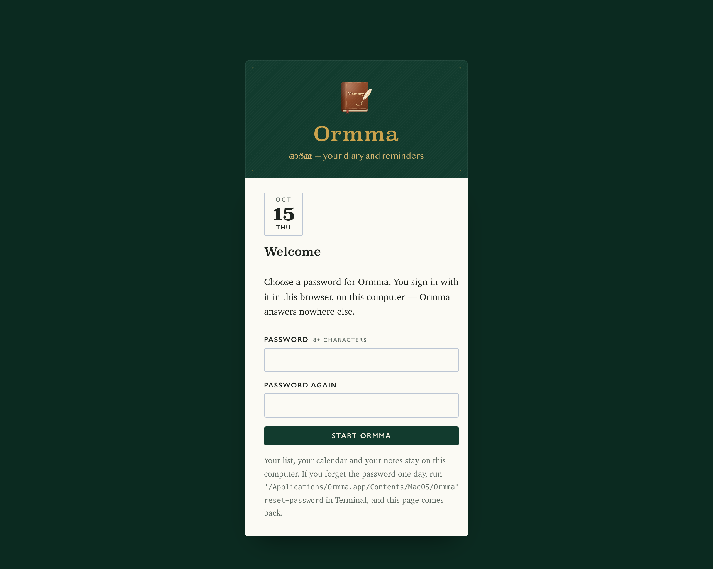

# Installing Ormma

Ormma runs on a computer that stays on, and you use it in the browser on that computer. There are three ways to run it:

| | For | Needs |
|---|---|---|
| [**The desktop app**](#the-desktop-app) | a Mac or a Windows PC — most people | nothing else: it brings its own Node |
| [**From source, on a Mac**](#from-source-on-a-mac) | a Mac you develop on, or want to run from git | Node 22.13 or newer |
| [**With Docker**](#with-docker) | Linux, a home server, any computer with Docker | Docker |

Whichever you choose, link a **spare WhatsApp number** if you can — Ormma sends through a linked device, an unofficial client, and WhatsApp can ban a number that uses one ([why](../README.md#a-word-about-whatsapp)).

## The desktop app

Download it from the [latest release](https://github.com/AnalytixKraft/Ormma/releases/latest):

- **Mac** — `Ormma-<version>-mac.dmg`: Apple silicon and Intel, macOS 13.5 (Ventura) or newer.
- **Windows** — `Ormma-<version>-windows-setup.exe`: Windows 10 or 11, 64-bit.

Each release lists the files' SHA-256 sums, to check a download against.

### On a Mac

1. Open the `.dmg`, and drag **Ormma** onto **Applications**.
2. Open Ormma from Applications (or Launchpad, or Spotlight).

The first time, macOS says it could not check Ormma for malware: the app is not yet signed with an Apple Developer ID, so macOS cannot tell who made it. To open it anyway:

1. Click **Done** (not *Move to Bin*).
2. Open **System Settings → Privacy & Security**, scroll down to *“Ormma” was blocked to protect your Mac*, and click **Open Anyway**. Give your Mac's password when it asks.
3. Click **Open** in the box that follows.

macOS remembers this: it asks only once. (If you would rather, the same in Terminal: `xattr -dr com.apple.quarantine /Applications/Ormma.app`.)

Ormma has no window and no Dock icon of its own — it runs in the background and opens in your browser. Open the app again any time to get back to it. It also starts when you sign in to your Mac: it is in **System Settings → General → Login Items & Extensions** (macOS tells you when it is added).

### On Windows

1. Run `Ormma-<version>-windows-setup.exe`.
2. Windows may say *Windows protected your PC* — the installer is not yet signed, so SmartScreen does not know it. Click **More info**, then **Run anyway**.
3. Follow the installer. It installs for you alone, in your own folder — no administrator needed — and puts **Ormma** in the Start menu and on the desktop.

At the end, *Open Ormma* opens it in your browser. Ormma runs in the background with no window; open it from the Start menu any time to get back to it. It starts when you sign in to Windows — turn that off, if you must, in **Task Manager → Startup apps**.

### The first time

Ormma opens in your browser at <http://localhost:3210> and asks you to **choose a password**. You sign in with it from then on; Ormma answers only on this computer.



Then follow **Getting started** on the Today page — link the WhatsApp number, add your people, choose where each wish goes, and turn sending on. [The user guide](guide.md#getting-started) has each step.

### Keep it running

- **Keep the computer on and awake.** Asleep, it sends nothing; a message whose time passed goes out as soon as the computer wakes — that day, never twice, and never on a later day.
  - Mac: **System Settings → Battery (or Energy) → Prevent automatic sleeping when the display is off**, on power adapter — and on a MacBook, keep the lid open.
  - Windows: **Settings → System → Power → Screen and sleep**: *When plugged in, put my device to sleep after* → **Never**.
- **Open WhatsApp on the linked phone at least every two weeks.** WhatsApp unlinks devices whose phone has been offline for about 14 days; Settings → WhatsApp then asks you to link it again.
- If Ormma itself stops, it starts again on its own (in under a minute), and again whenever you sign in.

### Where things are

| | Mac | Windows |
|---|---|---|
| Your data — the list, calendar, notes, and the WhatsApp link | `~/Library/Application Support/Ormma` | `%LOCALAPPDATA%\Ormma` |
| Its settings file (`ormma.env`) | in the data folder | in the data folder |
| Its logs | `~/Library/Logs/Ormma` | `%LOCALAPPDATA%\Ormma\logs` |
| The app | `/Applications/Ormma.app` | `%LOCALAPPDATA%\Programs\Ormma` |

The data folder holds a live credential for your WhatsApp account (the `whatsapp` folder in it): keep it private, and never copy it to a second computer while the first one runs — two copies of one WhatsApp link take it from each other.

`ormma.env` is the desktop app's `.env`: made on the first run, with secrets made up for this computer. Change it to add a [Claude API key](guide.md#with-claude) (`ANTHROPIC_API_KEY=`), or to move Ormma to another port (`APP_PORT=`, if something else on the computer uses 3210) — then restart Ormma.

### Ormma's commands

What the icon does is `Ormma`; the rest are for now and then. On Windows the ones you need are in the Start menu, under **Ormma**. On a Mac, type them in Terminal, as `/Applications/Ormma.app/Contents/MacOS/Ormma <command>`:

| Command | What it does |
|---|---|
| *(none)* | Start Ormma if it is not running, and open it in the browser |
| `stop` | Stop it — until you open it again, or next sign in |
| `restart` | Stop it and start it again (after changing `ormma.env`) |
| `status` | Whether it runs, its version, and where its things are |
| `backup [folder]` | A copy of the database — your people, calendar, notes and settings, not the WhatsApp link — in *Documents/Ormma backups* unless you name a folder |
| `restore <file>` | Put a backup back. Everything since it was made is replaced by what it holds (the database it replaces is kept beside it, as `before-restore-….db`) |
| `reset-password` | Forget the password: Ormma opens and asks for a new one |
| `uninstall` | Stop it, and stop it starting when you sign in. Your data stays |

On Windows, the same from a Command Prompt: `"%LOCALAPPDATA%\Programs\Ormma\Ormma.exe" <command>`.

### Updating

Download the new version and install it the way you did the first: on a Mac, drag it onto Applications and choose **Replace**; on Windows, run the new installer. Then open Ormma — it stops the old version and starts the new one, down for a few seconds. Your data, your password and the WhatsApp link stay as they were.

### Moving to another computer

1. On the old one, `Ormma backup`, and copy the file it makes to the new computer.
2. Install Ormma on the new one, choose a password, and `Ormma restore <that file>`.
3. Link the phone again in Settings → WhatsApp (a backup never holds the WhatsApp link, on purpose). Then uninstall Ormma from the old computer.

### Uninstalling

- **Mac**: in Terminal, `/Applications/Ormma.app/Contents/MacOS/Ormma uninstall` (it stops Ormma and takes it out of Login Items), then move Ormma from Applications to the Bin.
- **Windows**: **Settings → Apps → Installed apps → Ormma → Uninstall** (or Start menu → Ormma → Uninstall Ormma).

Either way your data stays, in the data folder [above](#where-things-are) — delete that folder to remove it too. On the phone, WhatsApp → Settings → Linked devices lists Ormma until you log it out there.

### If something is wrong

- **“Another Ormma already answers at http://localhost:3210”** — Ormma also runs another way on this computer (from source, or in Docker). Use that one, or stop it first. Never run two with one WhatsApp link.
- **“Another program is using port 3210”** — close that program, or give Ormma another port: `APP_PORT=` in `ormma.env`.
- **“Move Ormma to your Applications folder first”** — macOS is running it from the disk image, or from Downloads: drag it to Applications, and open it there.
- **Anything else** — the logs ([where](#where-things-are)) say what happened: `ormma.log` is Ormma starting and stopping, `app.log` and `whatsapp.log` are the two parts.

## From source

For a Mac you develop on, a home server, or Linux — anything the desktop app does not cover. Get the code and make its `.env`:

```bash
git clone https://github.com/AnalytixKraft/Ormma.git
```

```bash
cd Ormma
```

```bash
bash scripts/setup.sh
```

`setup.sh` creates `.env` and fills in the secrets. Run in a terminal, it asks you to choose the app's password (or makes one up; see it with `grep ADMIN_PASSWORD .env`). Then start it, one of two ways.

### From source, on a Mac

Needs Node 22.13 or newer (fnm, nvm or Homebrew; the newest one found is used):

```bash
bash scripts/native/install.sh
```

That copies this version of the code to `~/Library/Application Support/WishCalendar/release`, installs its Node packages there, and two launchd agents — the app and the WhatsApp bridge — that start when you sign in and start again if they ever stop. They run that copy, so editing this folder or switching git branches changes nothing until you run `install.sh` again (after `git pull`, say). An update stops the old version, starts the new one and checks both answer — a couple of seconds — and if the new one does not come up, it puts the old one back and starts it again, so an update never leaves it down. Data lives in `~/Library/Application Support/WishCalendar`, logs in `~/Library/Logs/WishCalendar`. Both listen on 127.0.0.1 only. `scripts/native/status.sh` says how it is; `scripts/native/uninstall.sh` stops it and keeps the data.

### With Docker

Any computer with [Docker Desktop](https://www.docker.com/products/docker-desktop/) or Docker Engine:

```bash
docker compose up -d --build
```

Moving from Docker to the Mac version? `bash scripts/native/migrate-from-docker.sh` stops the Docker containers and brings the database and the WhatsApp link across — no QR to scan again — then run `install.sh`. Never run the two side by side: two bridges on one WhatsApp link take it from each other.

Open <http://localhost:3210>, sign in with that password, and follow [Getting started](guide.md#getting-started).

### Keep it running, from source

- **On a Mac, from source**: launchd starts both parts when you sign in and restarts them if they stop — nothing to set.
- **In Docker**: the containers restart on their own (`restart: unless-stopped`) — as long as Docker itself starts. In Docker Desktop: **Settings → General → Start Docker Desktop when you sign in**.
- A sleeping Mac runs nothing. Stop it sleeping: **System Settings → Battery (or Energy) → Prevent automatic sleeping when the display is off**, on power adapter — and on a MacBook, keep the lid open.
- If the computer is off or asleep at a message's time, it goes out as soon as the computer is back — later that day, never twice, and never on a later day. A wish whose day ended first is named in the next morning's [alert](guide.md#alerts).
- **Open WhatsApp on the linked phone at least every two weeks.** WhatsApp unlinks devices whose phone has been offline for about 14 days; Settings → WhatsApp then asks you to link it again.


### Reach it from anywhere

The app listens on `127.0.0.1` only. To use it from your phone or share it with a co-organiser, put it behind a [Cloudflare Tunnel](https://developers.cloudflare.com/cloudflare-one/connections/connect-networks/) on a hostname of yours:

1. In the Cloudflare dashboard: **Zero Trust → Networks → Tunnels → Create a tunnel** (type *Cloudflared*). Copy its token.
2. Add a **public hostname** to the tunnel — say `birthdays.example.com` — with service **`http://app:3210`**.
3. Put the token in `.env` as `CLOUDFLARE_TUNNEL_TOKEN=…`, then:

```bash
docker compose --profile tunnel up -d
```

Without a token, `cloudflared` cannot start. The tunnel reaches the app's pages only, never the bridge. (Running on the Mac without Docker, run `cloudflared` itself and point the hostname at `http://localhost:3210`.) The pages need the password, and failed sign-ins are throttled; for more — and with your notes in the app, you want more — put a Cloudflare Access policy in front of the hostname.


### Day to day

On a Mac, from source:

```bash
bash scripts/native/status.sh                  # running? WhatsApp connected?
```

```bash
tail -n 50 ~/Library/Logs/WishCalendar/app.log # what was sent, and what failed
```

In Docker:

```bash
docker compose ps                   # both should say (healthy)
```

```bash
docker compose logs --tail 50 app   # what was sent, and what failed
```

Either way — the scripts find where it runs:

```bash
bash scripts/backup.sh              # the database, into backups/
```

```bash
bash scripts/restore.sh backups/birthdays-2026-09-30-120000.db
```

A backup holds people, settings and the record of what was sent. It does not hold the WhatsApp link — after restoring on a new computer, link the phone again.

To update to a newer version: `git pull`, then `bash scripts/native/install.sh` (Mac) or `docker compose up -d --build` (Docker).

